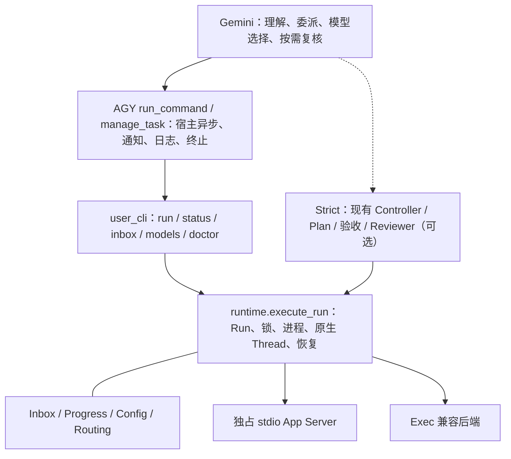

# AGY Codex v0.3 — 最终收敛实施方案

- 状态：GPT 与 Gemini 架构讨论已收敛；切片 0 本机验证待执行。
- 基线：运行时 `66e1c43`；讨论截至 Gemini Round 2 `89955a2`，结合 GPT Round 3。
- 上游依据：[原始提案](v0.3-adaptive-runtime-refactor.md)、[独立评审](v0.3-adaptive-runtime-review.md)、[双方讨论](v0.3-adaptive-runtime-discussion.md)。本文替代原长提案作为实施依据，历史文档不删除。
- 目标：让使用 AGY Codex 比直接使用 Codex 更有价值。减少重复解析、强制复审、无效返修及框架开销，保留可靠执行与真实工程验收。

## 1. 最终架构

普通任务不经过 run_workflow、Ticket 快照或强制 Reviewer。Strict 调用同一 Runtime，保留必要验收。Antigravity 管理前台 CLI 的异步运行和通知；CLI 持有 Windows Job Object 和执行锁直到实际进程结束。Codex 原生 Thread 是会话历史的唯一事实来源。无自建后台 daemon、wait、events cursor、会话注册表、数据库、前端、三模式状态机。

默认策略：用户已经授权时选择最短可行路径，简单任务一次 run，相关任务同 Thread 增量续跑，按需测试/复核/返修。不要以多轮协作为目标；不默认 Heavy，不强制长计划。

## 2. 接口与数据契约

五个核心 CLI 操作（参数细节可按本机宿主实际能力调整，保留 --repo 兼容别名）：

| 命令 | 用途 |
|---|---|
| run | 前台执行；新任务或 --resume RUN_ID/THREAD_ID/last；支持 prompt file、model、effort、read-only/授权 sandbox；可选 output schema |
| status | 离线读取工作区最近/活跃 Run、结果路径、进度，兼容 Strict 摘要；默认无模型调用、无全仓 hash |
| inbox | 以 Run/Turn 为锚点的 steer / queue / interrupt / status；沿用现有 Maildir |
| models | 按需发现原生模型、Provider 和额度；可按需刷新 |
| doctor | 显式环境诊断；非 Git 为信息项，可探测 windowsSandbox/readiness |

run 返回紧凑执行摘要和结果路径，完整答复/日志保存在本地。默认不要求 Worker JSON Schema，Strict 明确传入。只读与独立复审区分；只读使用实际后端 sandbox 权限，而不是提示词替代。

Run 最小字段：run_id、thread_id、continued_from、workspace_key、cwd、codex_home、host、backend、model_provider、codex_requested、sandbox、status、turn_pending、active_turn_id、inbox_window、child_pid/last_child_pid、result_path、usage、started_at/ended_at。按需要保留旧运行时所需进程归属证据；不维护可独立变化的双份状态。执行完成不代表工程 PASS；验证限制与产物缺陷分开记录。未知提交必须核对，不重发。

--resume last 仅解析当前工作区插件记录的最近一次 Run。旧历史 Run 不覆盖；续跑创建新 Run 并链接。直接 Thread ID 必须按需核对归属、空闲与 Provider 等约束，不跨项目猜测；未对账的活动或未知后继不能被跳过。按需调用 thread/list，日常 status 不启动 App Server。对账优先使用本机支持的 thread/resume(excludeTurns=true) 及 thread/turns/list 分页，避免全量历史水合；核对原生终态及 Thread/Turn 身份后再记录结果。

## 3. 源码映射与兼容

| 文件 | 改动 |
|---|---|
| runtime.py（新增） | 从 Controller 抽取进程、WindowsJob/_child-gate、元数据、公共错误、锁、EventSummary、Codex 配置辅助；增加工作区解析、Run 记录、execute_run/reconcile_run |
| controller.py | re-export 必要旧公共符号；Controller.run 直接调用共享 execute_run，回合关联 run_id；保留 Strict 合同、基线、验收及旧证据读取 |
| backends/codex_app_server.py | 解除 Controller/固定 Schema 依赖；共享 RunContext；参数化 sandbox；移除热路径全量 discover；保留 RPC、身份、恢复与 Inbox 语义 |
| backends/codex_exec.py | 同一请求/结果契约、可选 Schema、非 Git --skip-git-repo-check；保留安全进程调用 |
| backends/usage.py | 改公共导入；保留 active Turn 归属、累计值去重与历史基线 |
| inbox.py | 锚定 Run/Turn；旧记录可读；保留原子窗口密封、ACK、未知交付不重放 |
| progress.py | 原生事件投影、节流 stdout 和进度文件；移除长任务 12 条静默上限 |
| user_cli.py | 五命令入口；兼容旧 status/inbox 使用；非 Git 支持 |
| config.py / routing.py | 保留用户配置；消除冗余发现；Provider 约束保留；确有收益再加轻量 TTL |
| agy_adapter.py / plans.py / product.py | Strict 继续可用；按需 Reviewer，减少 doctor、status 和 snapshot 开销 |
| SKILL.md / agents/agy-codex.md | 首切片同步重写，普通任务改用宿主 run_command |
| agents/agy-codex-reviewer.md | 切片 2，仅在宿主验证支持的前提下提供极简只读定义 |

不机械迁移目录或拆出大量空壳模块。依赖方向 Strict → Runtime → Backends。公共符号 re-export 是兼容手段，不要求 mock patch 路径完全不变；现有测试按真实模块所有权作必要调整。不维护临时第二套 backend。旧未完成 Ticket 使用受控恢复兼容路径，先核实旧 pending/进程/Inbox，不擅自把旧活动记录当完成。不能安全迁移时保留旧证据、说明最小人工恢复动作。

## 4. 工作区与权限

- Git：复用实际 worktree 的 gitdir/superagent 与原 worktree.lock，轻量及 Strict 共用；未完成 Strict 占用不可静默绕过。
- 非 Git：规范化根路径，用户态 workspaces/<path hash>/ 保存 workspace.json、锁、runs 等（可配置状态根；不能用独立状态根规避互斥）。不在文档交付目录写隐藏运行元数据，不初始化 Git。
- 父子目录写入冲突使用路径分量比较；启动登记临界区内原子完成重叠检查、获取工作区锁、登记，执行期间释放短全局登记锁。检查插件自身活动写入范围，包括嵌套 Git/非 Git 根。不增加全系统文件监控。异常退出按真实锁与进程归属对账。
- 默认保持 workspace-write 或已授权范围，显式只读实际限制写权限；不自动 full-access、联网或提升权限。保留 Provider allowlist/原生身份核对；移除 catalog 热查询并不允许静默换 Provider。App Server → Exec fallback 只在确定未提交时允许。

## 5. 四个实施切片

### 切片 0：本机关键假设验证

由 Gemini 本机执行，目标约 15 分钟，不要求长期调研或全量回归。已有实测已确认 AGY 同步转后台、manage_task 日志/kill、并发 run_command，Codex 0.171.0 App Server 非 Git 启动及 Exec 非 Git 参数支持。尚需：

1. AGY 自定义主 Agent 的空闲完成唤醒：短脚本运行、通知超时后继续、完成后无需用户输入即可读取结果。
2. 用户中途插话时第二条 run_command 投递 Inbox 不影响后台 Worker。
3. manage_task kill、UI 取消及关闭 AGY 对持有 WindowsJob 的子孙进程与锁的真实影响。
4. 临时自定义只读 reviewer 的注册、run_workflow 调用、工具权限及结构化返回；检查 self 可用性但不等同独立审查。

如自动唤醒不可用，保留原生前台等待/宿主任務面板收集结果，不建 daemon；如中途交互不支持，明确该宿主限制，保留 Inbox 原子能力；如终止仍有残留，修复进程所有权再启用对应后台路径；如 Reviewer 不可用，Strict 保留 REVIEW，普通任务不受影响。无需继续探索不存在的本机 mcp-server，也不改用未启动的 daemon queue。

### 切片 1：共享 Runtime 与默认轻量路径

完成 §3 运行时抽取，Strict Controller 同时接入（零重复 backend），前台 run 支持 Git/非 Git、原生续跑、可选 Schema、权限、进度及 Inbox；实现 §4 互斥。取消每轮热路径 discover；显式请求/Provider 约束由原生能力及本地配置核对。

同时重写 Skill 和主 Agent。普通任务默认一次委派、关联任务复用、按需验证、足够胜任的模型档位；普通流程完全不启动 research、全仓快照、强制 test_commands。保留领域 Skill（HWB、Office 等），任务特定依赖可轻量探测，不建立全局 Office 门禁。

针对性回归：新 Run、原生续跑、同一 Thread 的 Token 过滤、非 Git 中文/空格路径、父子并发竞争、轻量/Strict 互斥、read-only、Inbox/中断/未知提交；旧 Strict 流程继续使用共享运行时并保持必要回归。完成即开始普通路径试用。

### 切片 2：Strict 减负与 Reviewer

在已验证的宿主上提供插件自己的只读 Reviewer，允许配置名称；移除固定 research。不可用保留 REVIEW 与成果，不重复 Worker。self 仅在明确允许时作为非独立复核，不能冒充独立审查。独立代码审查优先新只读 Thread；原生 review/start 仅在实际场景有收益时接入，不为此增加另一条执行内核。

取消重复全套 doctor；status 默认只读记录；Strict 合并冗余全仓扫描，保留关键快照完整性检查，不将 mtime/size 单独当内容证明。先测量收益再决定是否需要缓存。不扩展 Strict 新功能。

验证已有 Ticket/Plan 读取、未完成恢复、验收不降级、Reviewer 缺失、轻量/Strict 互斥、Windows 进程清理。

### 切片 3：受控 A/B 与端到端验证

A 组：同模型/effort、相同输入、工作区及库环境，对照原生 Codex、v0.2（适用场景）、v0.3。对单文件修改、关联两步任务，记录固定编排税，目标额外 3–5 秒以内、零强制额外模型调用、状态查询无模型调用。原生或 v0.2 不支持的场景标 N/A，不假造数值。

B 组：用三份相关 Office 文档及普通代码开发测实际默认策略；资料解析一次后复用结构化产物，注意源文件变化和来源追溯。确保所需库/专业工具可用，不把缺库故障混进对照。验证后台长任务、观察超时、插话纠偏、取消、旧 Strict。记录 wall time、模型调用、已观测 Token、资料解析次数、用户干预、交付质量及验证结果。关联任务目标较旧版总耗时降低 50% 以上（设计目标，非保证）；不牺牲必要验证以提速。Token 不等于订阅额度。

沿用本地 Windows 测试与手动 CI。建议独立分支 refactor/adaptive-runtime，按切片提交；不自动合并或触发 CI。实测发现真实缺陷可直接在范围内修复，不再增加架构门禁。

## 6. 不做

不建额外 Supervisor、Daemon、MCP Server、通用 Agent 消息总线、Session 数据库、前端、独立 wait/events CLI、强制 Worktree、自动多模型辩论或默认强制复审。不把 Office 依赖、HWB 或其他专业工具集成进 Runtime。不直接复制无明确许可或许可证义务未处理的上游源码。先用已有可靠内核及宿主原生能力解决实际痛点。

## 7. 下一步

Gemini 读取本文及 Round 3，完成切片 0 并记录实际结果（可以追加在讨论文档末尾或单独短记录）；无需重新进行架构审计。若出现影响基本设计的真实反证，提出最小调整。其他实现细节按本方案直接收敛。

本方案为架构设计结论，运行时尚未修改；宿主验证、真实性能及旧数据迁移仍待实施验证。
