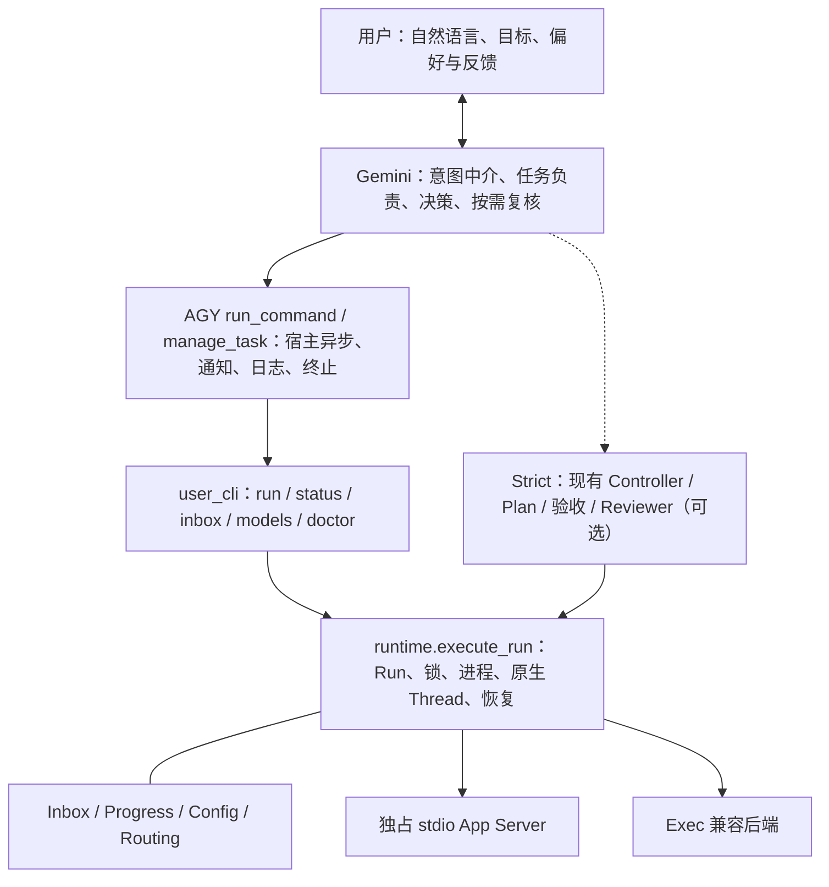

# AGY Codex v0.3 — 最终收敛实施方案

- 状态：运行时架构与双模型协作原则已收敛；切片 0 核心探针据[本机验证记录](v0.3-adaptive-runtime-discussion.md#切片-0--gemini-本机验证结果)已通过，可进入切片 1；自定义主 Agent 的 UI 取消/关闭及静态 Reviewer 注册留待实施期点验。
- 基线：运行时 `66e1c43`；讨论截至 Gemini Round 2 `89955a2`，结合 GPT Round 3。
- 上游依据：[原始提案](v0.3-adaptive-runtime-refactor.md)、[独立评审](v0.3-adaptive-runtime-review.md)、[双方讨论](v0.3-adaptive-runtime-discussion.md)。本文替代原长提案作为实施依据，历史文档不删除。
- 目标：让使用 AGY Codex 比直接使用 Codex 更有价值。对内是双模型自主协作，对外是一个统一的 Agent；用户只与 Gemini 沟通，无需学习如何指挥 Codex、反复催促或承担模型间协调工作。减少重复解析、强制复审、无效返修及框架开销，同时提高首次交付完成度、工程质量及自主性。

## 1. 最终架构

普通任务不经过 run_workflow、Ticket 快照或强制 Reviewer。Strict 调用同一 Runtime，保留必要验收。Antigravity 管理前台 CLI 的异步运行和通知；CLI 持有 Windows Job Object 和执行锁直到实际进程结束。Codex 原生 Thread 是 Codex 会话历史的唯一事实来源；Gemini 保留宿主原生对话，不同步双方完整历史。无自建后台 daemon、wait、events cursor、会话注册表、数据库、前端、三模式状态机。

默认策略：用户已经授权时选择最短可行路径，简单任务一次 run，相关任务同 Thread 增量续跑，按需测试/复核/返修。不要以多轮协作为目标；不默认 Heavy，不强制长计划。

### 1.1 产品原则与职责

核心原则：意图中介、目标一致、上下文复用、认知独立、双向纠偏、自主执行、最小编排。发散地思考、果断地决策、主动地执行、严谨地验证。Gemini 的发散与能动性、Codex 的技术深度与严谨性是协作设计的经验依据，不是固定能力排名；不限制任一模型的思考方式，也不将模型名称或档位当作正确性的依据。

| 角色 | 职责与决策权 |
|---|---|
| 用户 | 产品目标、偏好、明确约束及超出既有授权的重大取舍 |
| Gemini（唯一用户交互入口） | 理解意图、补全合理语义、与用户对齐真实需求、选择协作策略与模型档位、委派、内部解决日常决策、持续推进及综合交付；对用户最终目标负责 |
| Codex（自主工程协作者、唯一项目 Agent 写入者） | 独立分析、技术决策、实现、排障、验证及产出证据；可纠正 Gemini 的技术假设并采用更优实现，不需要逐步征得同意 |
| Runtime / Strict | Runtime 负责真实执行状态、锁、进程、Thread、消息和恢复；Strict 按已声明的工程验收合同执行，不承担语义推理或任务决策 |

技术正确性由与问题相关的原始证据和实际行为判断，目标与体验由用户需求决定。常规、可逆、范围内的工程选择由双方自行处理；真实权限和项目约束保持有效。单写入机制不变，Gemini 不在同一工作区另起写入 Agent。

### 1.2 意图中介与目标导向委派

Gemini 是用户意图的代理人，不是 Codex 消息转发器。

- 结合当前对话、已有决定、工程状态与明确偏好理解自然语言；保留用户原话中决定结果的语义，不要求用户改写成技术 Prompt。“继续”继承相关目标与授权；“全部做完”指完成整个已确定范围，而非只完成当前子任务。
- 对非关键歧义作合理、可逆的判断并推进；能从项目、既有上下文或工具查明的信息自行获取。仅在不同选择会实质改变用户目标且无法合理推断、授权不足或资源确实需要用户提供时，提出具体问题并给出建议。不擅自扩展产品目标或执行权限。
- 委派以用户目标、真实约束、相关事实/资料位置、预期成果及实际验证需求为主；技术路线默认只是可调整建议。用户明确确定的技术路线仍是约束。简单任务直接用短自然语言，不强制填表、计划或 JSON Schema。
- Codex 结束 Turn 只意味着一次执行结束，不意味着用户目标已经达成。Gemini 根据实际成果和剩余工作决定交付或续跑；对尚有明确收益、已获授权且可执行的工作，优先同 Thread 增量完成，不等待用户再说“继续”。
- 收到 Worker 的下一步建议、疑问、失败或限制时，Gemini 独立判断其真实性和可解决性；能在现有权限内解决的自行决定、纠偏或组织排障。**止损准则**：优先一次完成目标，只有仍有明确剩余任务且有可行推进路径才续跑；若连续两次同方向续跑没有可观察的新进展（如已证实/排除的关键根因、实际修复、通过的相关验证或可用产物）或反复改 A 坏 B，停止重复尝试；能识别具体新证据或明显不同且值得尝试的方法时可调整一次方向，否则交付已有可用成果及真实卡点。不要为满足轮数机械续跑，也不要因轮数到了而放弃仍在有效推进的任务。不得机械循环或隐瞒失败。
- Gemini 向用户说明可观察成果、重要决策和必要验证，不转发原始 Worker 长文、内部状态术语或无价值的免责声明；不把“未测试”说成“通过”。

例如，用户说“抽屉卡卡的，要丝滑，不是立刻弹出”，应转为改善响应、帧稳定性和可中断动画的工程目标，保留合理过渡；UI 线程阻塞等根因仅是待核实假设，由 Codex 自主调查与修复。

### 1.3 Worker 默认执行原则

在切片 1 的 Skill 中提供精简、可复用的 Codex 委派行为规范，发起新任务时结合目标传递；相关续跑只补充新增要求、事实或纠偏，不机械重复整套指令。普通 CLI 仍允许原生 prompt file，不开发 Prompt Engine 或强制协议。（经本机 `codex-cli 0.171.0` rollout 实测，`ThreadStartParams.developerInstructions` 虽然保留原生 base 指令与 `AGENTS.md`，但会覆盖用户 `$CODEX_HOME/config.toml` 中自定义的 `developer_instructions`；按 Round 5 约定，不强行采用原生字段注入，沿用 Skill 新任务委派传递。）

- Optimize for the user's actual objective, not merely a prescribed sequence. Exercise independent technical judgment within the authorized scope.
- Treat another agent's proposal as a proposal, not a requirement or verified fact. Correct faulty assumptions and choose a simpler or better implementation when justified.
- Investigate uncertainty and recoverable failures. Make reasonable reversible assumptions, proceed, and fix directly related defects that materially affect the outcome.
- Do not substitute plans, audits, recommendations, risk descriptions or requests for routine approval for requested implementation. Complete the authorized objective rather than an arbitrary intermediate step.
- Prefer the simplest effective solution; avoid speculative abstractions, unnecessary gates and defensive mechanisms. Verify behavior proportionately to the actual task and consequences.
- Deliver actual artifacts, meaningful decisions and validation evidence. If genuinely blocked, complete achievable work and identify the specific remaining obstacle. Never fabricate completion or test results.

这些行为原则适用于执行任务，不改变只读审查、用户仅要求讨论/规划等意图，不覆盖项目 AGENTS.md、实际权限与 Strict 验收合同。

### 1.4 认知独立、双向纠偏与证据驱动

共享目标、事实、约束与证据，保持技术判断独立。不以双方达成一致为目标，不把另一模型的自信、身份或结论当作证据。

- 委派时区分用户要求、已观察事实（附可定位来源）、待核实假设、模型建议；不把分析结论混入硬性约束。这是**语义要求而非固定模板**：明确的小任务用一两句自然语言即可，仅在事实、假设、建议容易混淆且会影响结果时显式标注及附来源，不强制四段模板或预先全仓扫描。
- Codex 应纠正 Gemini 的错误技术假设、不可行设计或遗漏的工程细节；Gemini 应纠正 Codex 的无依据限制、过度设计、过早停止或遗漏的用户目标。双方均可发现对方的其他缺陷，不固化模型能力边界。
- 范围内的实现分歧可由 Codex 直接按更有依据的方案实施并说明原因；产品取舍由 Gemini 根据用户意图决定。存在实质技术争议时，使用源码、正式规范、原始数据、可复现计算、针对性实验/测试判断。证据适用范围取决于问题本身，测试通过不自动证明满足全部规范。
- 不为说服对方而反复辩论；没有新证据、有意义的替代方案或具体工程收益时停止复审/争论。对错误功能、遗漏需求、真实缺陷、可验证性能瓶颈优先整改；纯风格差异、无证据的假想风险和未来扩展不默认阻断。
- 独立审查有实际价值时，新建只读审查上下文，先提供原始目标、约束、实际 Diff/产物及可定位的原始证据；先形成独立判断，再按需读取 Worker 的实现理由、自评和验证解释。已经掌握 Worker 结论的主 Agent 复核不冒称独立审查。复用工程事实不等于继承执行者的判断。
- 不要求普通任务双模型分别完整分析、每轮盲审或固定双向评审。只有根因不明、重大架构取舍、实际证据矛盾或明确要求独立审计等场景，才增加有明确价值的独立分析。

### 1.5 上下文复用与按需取证

认知独立不等于上下文独立。一次探索、成果复用、局部验证；谁实际需要信息，谁负责首次获取。尤其是普通代码实现，Gemini 不必先读完整仓库再委派 Codex。

| 层级 | 内容 | 加载策略 |
|---|---|---|
| L0 任务上下文 | 用户目标、约束、授权、预期成果 | 新任务提供；续跑只补充变化 |
| L1 工程地图 | 项目规范、模块职责、关键入口、接口与来源索引 | 按相关性复用已有文档或探索结果 |
| L2 任务证据 | 相关源码、Diff、日志、计算、结构化资料 | 按需读取；关键或可疑事实局部核对 |
| L3 原始全量资料 | 完整工程、文档全集、历史记录 | 仅任务确实需要时深入，不默认两边全量加载 |

- 优先复用 AGENTS.md、项目文档、原生 Thread、现有 prompt file、Run result、Diff/日志及专业 Skill 产物。大规模探索或资料解析确实有复用价值时，可输出紧凑事实摘要、文件/符号/行号或页码索引、结构化提取结果；记录相关版本/来源，对已变更的关键资料按需更新。不得把未核实的摘要当作原始事实，也不为每个小任务生成上下文文档。
- 共享资料引用而非搬运全文；传递与当前任务相关的事实及增量。Gemini 通常只查看实际变更、成果、测试及关键源码；Codex 复用探索成果并读取足以支持实施的源码。必要的源码读取和关键核查不能为了节省额度而省略。
- Gemini 保留自己的用户对话；Codex 相关任务复用原生 Thread，包括同一功能续作、同一重构后续阶段、失败整改和相关资料处理。不相关的新任务、明确独立审查或历史假设严重污染且无法有效纠正时采用新上下文。不要为保持独立判断而频繁重建 Thread。
- 不复制双方完整对话或内部推理，不强制生成项目地图、全量摘要或索引，不新增 Context Manager、向量库、跨模型会话同步或额外缓存服务。共享磁盘资料可以降低重复搜索/解析，但两模型分别读取相同内容仍有各自上下文成本；不能将文件共享或 Thread 续跑等同于跨模型 KV Cache 共享或订阅额度节省。

### 1.6 自适应协作与完成判断

以下为 Agent 路由指导，不是新增 Runtime 模式、状态机或固定模型能力表。

| 场景 | 默认路径 |
|---|---|
| 普通问答、需求讨论 | Gemini 直接处理；需要技术证据才调用 Codex |
| 创意、产品、UI 设计 | Gemini 主导探索与目标对齐；需要实施时由 Codex 自主选择实现 |
| 简单代码、明确修改、普通文档制作 | 一次目标委派；足够胜任的模型/effort；按需验证 |
| Bug、性能排查 | Codex 直接调查、修复、验证；共享现象和日志，不固化猜测 |
| 大型重构、连续开发 | Gemini 明确整体目标和优先级，Codex 独立实施；按实际依赖复用 Thread 推进，不强制拆成多个 Ticket |
| 技术研究、工程计算、资料处理 | 由适合该任务的模型及现有专业 Skill/工具主导；共享提取结果，按需核查 |
| 高要求、明确合同或独立审计 | 使用现有 Strict 或针对性只读独立审查；保留明确验收要求 |

默认争取一次完成。Gemini 根据实际产物及验证判断是否达到用户目标：未完成且可继续时推进，完成则交付；任务复杂并不自动意味着 Strict，Strict 的明确验收要求也不因减负而降级。模型与 effort 依据任务难度、所需质量、已知额度及用户配置选择，不默认最高档，不增加专门的评分路由器。普通任务没有固定复审轮次，也不为首次交付而牺牲必要验证。

## 2. 接口与数据契约

五个核心 CLI 操作（参数细节可按本机宿主实际能力调整，保留 --repo 兼容别名）：

| 命令 | 用途 |
|---|---|
| run | 前台执行；新任务或 --resume RUN_ID/THREAD_ID/last；支持 prompt file、model、effort、read-only/授权 sandbox；可选 output schema |
| status | 离线读取工作区最近/活跃 Run、结果路径、进度，兼容 Strict 摘要；默认无模型调用、无全仓 hash |
| inbox | 以 Run/Turn 为锚点的 steer / queue / interrupt / status；沿用现有 Maildir |
| models | 按需发现原生模型、Provider 和额度；可按需刷新 |
| doctor | 显式环境诊断；非 Git 为信息项，可探测 windowsSandbox/readiness |

run 返回紧凑执行摘要和结果路径，完整答复/日志保存在本地。默认不要求 Worker JSON Schema，Strict 明确传入。只读与独立复审区分；只读使用实际后端 sandbox 权限，而不是提示词替代。

Run 最小字段：run_id、thread_id、continued_from、workspace_key、cwd、codex_home、host、backend、model_provider、codex_requested、sandbox、status、turn_pending、active_turn_id、inbox_window、child_pid/last_child_pid、result_path、usage、started_at/ended_at。按需要保留旧运行时所需进程归属证据；不维护可独立变化的双份状态。执行完成不代表工程 PASS；验证限制与产物缺陷分开记录。未知提交必须核对，不重发。

--resume last 仅解析当前工作区插件记录的最近一次 Run。旧历史 Run 不覆盖；续跑创建新 Run 并链接。直接 Thread ID 必须按需核对归属、空闲与 Provider 等约束，不跨项目猜测；未对账的活动或未知后继不能被跳过。按需调用 thread/list，日常 status 不启动 App Server。对账优先使用本机支持的 thread/resume(excludeTurns=true) 及 thread/turns/list 分页，避免全量历史水合；核对原生终态及 Thread/Turn 身份后再记录结果。

## 3. 源码映射与兼容

| 文件 | 改动 |
|---|---|
| runtime.py（新增） | 从 Controller 抽取进程、WindowsJob/_child-gate、元数据、公共错误、锁、EventSummary、Codex 配置辅助；增加工作区解析、Run 记录、execute_run/reconcile_run |
| controller.py | re-export 必要旧公共符号；Controller.run 直接调用共享 execute_run，回合关联 run_id；保留 Strict 合同、基线、验收及旧证据读取 |
| backends/codex_app_server.py | 解除 Controller/固定 Schema 依赖；共享 RunContext；参数化 sandbox；移除热路径全量 discover；保留 RPC、身份、恢复与 Inbox 语义 |
| backends/codex_exec.py | 同一请求/结果契约、可选 Schema、非 Git --skip-git-repo-check；保留安全进程调用 |
| backends/usage.py | 改公共导入；保留 active Turn 归属、累计值去重与历史基线 |
| inbox.py | 锚定 Run/Turn；旧记录可读；保留原子窗口密封、ACK、未知交付不重放 |
| progress.py | 原生事件投影、节流 stdout 和进度文件；移除长任务 12 条静默上限 |
| user_cli.py | 五命令入口；兼容旧 status/inbox 使用；非 Git 支持 |
| config.py / routing.py | 保留用户配置；消除冗余发现；Provider 约束保留；确有收益再加轻量 TTL |
| agy_adapter.py / plans.py / product.py | Strict 继续可用；按需 Reviewer，减少 doctor、status 和 snapshot 开销 |
| skills/agy-codex/SKILL.md / agents/agy-codex.md | 首切片同步重写：普通任务改用宿主 run_command；落实 §1.1–1.6 的意图中介、目标委派、Worker 行为、认知独立、上下文复用及自主推进；不再保留旧版默认三轮工作流指令 |
| agents/agy-codex-reviewer.md | 切片 2，提供极简只读定义；按 §1.4 独立取证、判断问题实际价值；验证静态注册或使用已验证的动态注册方式 |

不机械迁移目录或拆出大量空壳模块。依赖方向 Strict → Runtime → Backends。公共符号 re-export 是兼容手段，不要求 mock patch 路径完全不变；现有测试按真实模块所有权作必要调整。不维护临时第二套 backend。旧未完成 Ticket 使用受控恢复兼容路径，先核实旧 pending/进程/Inbox，不擅自把旧活动记录当完成。不能安全迁移时保留旧证据、说明最小人工恢复动作。

## 4. 工作区与权限

- Git：复用实际 worktree 的 gitdir/superagent 与原 worktree.lock，轻量及 Strict 共用；未完成 Strict 占用不可静默绕过。
- 非 Git：规范化根路径，用户态 workspaces/<path hash>/ 保存 workspace.json、锁、runs 等（可配置状态根；不能用独立状态根规避互斥）。不在文档交付目录写隐藏运行元数据，不初始化 Git。
- 父子目录写入冲突使用路径分量比较；启动登记临界区内原子完成重叠检查、获取工作区锁、登记，执行期间释放短全局登记锁。检查插件自身活动写入范围，包括嵌套 Git/非 Git 根。不增加全系统文件监控。异常退出按真实锁与进程归属对账。
- 默认保持 workspace-write 或已授权范围，显式只读实际限制写权限；不自动 full-access、联网或提升权限。保留 Provider allowlist/原生身份核对；移除 catalog 热查询并不允许静默换 Provider。App Server → Exec fallback 只在确定未提交时允许。

## 5. 四个实施切片

### 切片 0：本机关键假设验证

据[双方讨论文档中的切片 0 记录](v0.3-adaptive-runtime-discussion.md#切片-0--gemini-本机验证结果)，Windows / Codex 0.171.0 / Antigravity 2.0 的核心探针已通过：默认 Main Agent 同步转后台、观察超时后继续及完成自动唤醒；并发 Maildir 投递；manage_task kill 清理 WindowsJob 四层进程与锁；动态注册纯只读 Reviewer 并获得结构化结果。self 继承写权限，不能冒充只读独立审查。此前非 Git App Server/Exec 启动假设亦有验证记录。

实施期顺手点验：切片 1 在自定义 agy-codex 主 Agent 中验证插话、UI 取消及关闭窗口后的进程/锁清理；切片 2 核对静态 Reviewer 注册，不支持时优先动态注册。探针通过不等同于新 Runtime 端到端验证完成，不重复开启架构评审。

如自动唤醒不可用，保留原生前台等待/宿主任務面板收集结果，不建 daemon；如中途交互不支持，明确该宿主限制，保留 Inbox 原子能力；如终止仍有残留，修复进程所有权再启用对应后台路径；如 Reviewer 不可用，Strict 保留 REVIEW，普通任务不受影响。无需继续探索不存在的本机 mcp-server，也不改用未启动的 daemon queue。

### 切片 1：共享 Runtime 与默认轻量路径

完成 §3 运行时抽取，Strict Controller 同时接入（零重复 backend），前台 run 支持 Git/非 Git、原生续跑、可选 Schema、权限、进度及 Inbox；实现 §4 互斥。取消每轮热路径 discover；显式请求/Provider 约束由原生能力及本地配置核对。

同时重写 Skill 和主 Agent，落实 §1.1–1.6（与 Runtime 抽取同等重要）。普通任务默认一次目标委派；Gemini 独占用户沟通并负责实际目标完成，Codex 自主技术决策、排障、实现；同 Thread 增量续跑，事实复用、按需取证、双向纠偏；普通流程不启动固定 research、全仓快照或强制 test_commands。保留领域 Skill（HWB、Office 等），任务特定依赖可轻量探测，不建立全局 Office 门禁。行为规范保持短小，避免主 Agent 和 Skill 重复大段规则；将通用原则与任务特定内容按需传递给 Worker，不只是写给 Gemini。

针对性回归：新 Run、原生续跑、同一 Thread 的 Token 过滤、非 Git 中文/空格路径、父子并发竞争、轻量/Strict 互斥、read-only、Inbox/中断/未知提交；旧 Strict 流程继续使用共享运行时并保持必要回归。完成即开始普通路径试用。

### 切片 2：Strict 减负与 Reviewer

在已验证的宿主上提供插件自己的只读 Reviewer，允许配置名称；移除固定 research。不可用保留 REVIEW 与成果，不重复 Worker。self 仅在明确允许时作为非独立复核，不能冒充独立审查。独立代码审查优先新只读 Thread；原生 review/start 仅在实际场景有收益时接入，不为此增加另一条执行内核。

取消重复全套 doctor；status 默认只读记录；Strict 合并冗余全仓扫描，保留关键快照完整性检查，不将 mtime/size 单独当内容证明。先测量收益再决定是否需要缓存。不扩展 Strict 新功能。

验证已有 Ticket/Plan 读取、未完成恢复、验收不降级、Reviewer 缺失、轻量/Strict 互斥、Windows 进程清理。Reviewer 按 §1.4 先独立检查原始需求与实际变化，再按需读取 Worker 解释；使用已有调用路径提供相关材料，不开发新的盲审子系统。

### 切片 3：受控 A/B 与端到端验证

A 组：同模型/effort、相同输入、工作区及库环境，对照原生 Codex、v0.2（适用场景）、v0.3。对单文件修改、关联两步任务，记录固定编排税，目标额外 3–5 秒以内、零强制额外模型调用、状态查询无模型调用。原生或 v0.2 不支持的场景标 N/A，不假造数值。

B 组：用三份相关 Office 文档及普通代码开发测实际默认策略；资料解析一次后复用结构化产物，注意源文件变化和来源追溯。确保所需库/专业工具可用，不把缺库故障混进对照。验证后台长任务、观察超时、插话纠偏、取消、旧 Strict。记录 wall time、模型调用、已观测 Token、资料解析次数、用户干预、交付质量及验证结果。关联任务目标较旧版总耗时降低 50% 以上（设计目标，非保证）；不牺牲必要验证以提速。Token 不等于订阅额度。

C 组：把协作行为纳入真实任务 A/B，不要求每次开发都执行此测试。至少覆盖下列代表性案例，可与 A/B 组已有用例合并，避免重复搭建测试框架：

| 场景 | 可核对观察点（另保留实际交付结果） |
|---|---|
| 模糊体验反馈（如动画卡顿但保留过渡） | 实现保留用户所需体验（如动画过渡），检查真实代码/运行表现；不把“读过源码”本身当作改善成功 |
| 委派中包含错误但合理的根因假设 | 利用源码、可复现证据或测试否定预埋错误假设，并修复真实根因 |
| Worker 提出不必要门禁、过度设计或提前停止 | 在不需要真实用户决策的已授权任务内，用户零次催促继续即获得完整且适当验证的交付；另可复用该用例核对“连续无进展及时止损”与“持续有效进展正常推进” |
| 同一工程连续开发或多文档复用 | 相关步骤复用原生 `thread_id`，源资料未重复全量解析/探索（按可见命令、日志和产物核对，不推算不可见 Gemini Token） |
| 明确独立审查且已有强烈先验结论 | 新建隔离只读审查上下文，初判不接收 Worker 自评并发现预埋真实缺陷与证据（Codex 用新 `thread_id` + `read-only`；Gemini 用独立只读子代理） |
| 真正需要用户决策或遇到无法解决的权限障碍 | 一次性给出具体障碍与证据、可用成果、最小用户动作/建议；不虚报 PASS，不重复无效重试 |

统一记录用户体验与工程效果：首次用户请求的实际目标完成度（按该任务预先约定的可观察成果判断，不按 Turn 数）、用户干预次数（区分真实决策与无意义催促/重复授权）、可恢复障碍自主解决情况、重复探索/解析次数、无实际收益的复审/返修轮次、端到端交付耗时及正确性/完整性/可维护性/验证结果。优先使用已有 Run、日志和人工任务评分，普通执行不为统计新增强制调用、遥测或复杂计分系统。分别记录可观测的 Gemini/Codex 用量；不可见指标标 N/A，不推算另一模型 Token 或订阅额度。协作优化须用实际体验与证据检验，不预设模型必然遵守行为指令。

沿用本地 Windows 测试与手动 CI。建议独立分支 refactor/adaptive-runtime，按切片提交；不自动合并或触发 CI。实测发现真实缺陷可直接在范围内修复，不再增加架构门禁。

## 6. 不做

不建额外 Supervisor、Daemon、MCP Server、通用 Agent 消息总线、Session 数据库、前端、独立 wait/events CLI、强制 Worktree、自动多模型辩论或默认强制复审。不建 Context Manager、全量仓库索引器、跨模型历史同步、Prompt Engine、反防御检测器、独立评分路由器或额外审批层。上下文与认知协作原则由 Agent/Skill/委派行为承担，不增加 Runtime 职责。不把 Office 依赖、HWB 或其他专业工具集成进 Runtime。不直接复制无明确许可或许可证义务未处理的上游源码。先用已有可靠内核及宿主原生能力解决实际痛点。

## 7. 下一步

Gemini 读取本文及切片 0 实测记录，直接进入切片 1：共享 Runtime 与普通执行路径、主 Agent/Skill/Worker 行为同步落地。按原四切片推进，不新开架构讨论或新增实施切片。若出现影响基本设计的真实反证，作最小调整；其他实现细节直接自主收敛。

本次文档更新统一了运行时架构和双模型协作设计。切片 0 结果来自仓库已有本机探针记录；文档更新不代表运行时、Agent 指令或测试代码已实现，也不代表性能目标已达成。后续以实际工程产物、端到端验证及用户体验为准。
