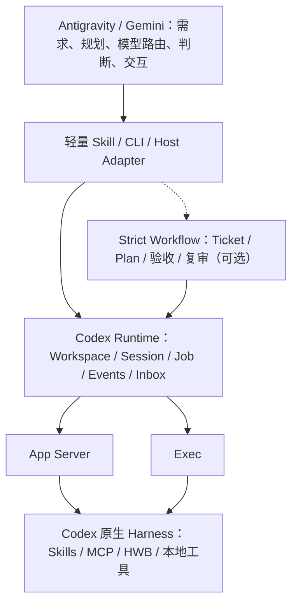
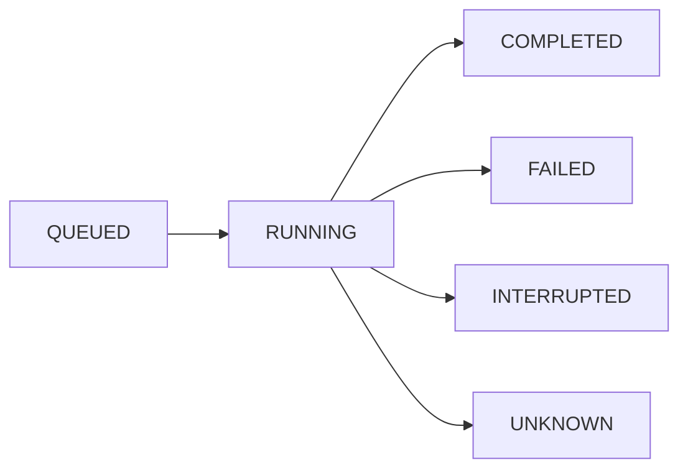

# AGY Codex v0.3.0 重构方案：轻量化 Agent 协作运行时

- 状态：设计提案，待 Gemini 独立审查；尚未开始实现。
- 基线：[`66e1c43`](https://github.com/Kylinghu/agy-codex/commit/66e1c43987f566feefef6468c1d28ed5fcba6a12)。
- 范围：AGY Codex 插件、运行时与编排策略，不涉及 HWB、Office 专业工具的内部实现。
- 目标：减少默认编排成本，使协作比直接使用 Codex 更有价值；保留已验证的 Windows、原生 Session、App Server、Inbox、恢复及用量统计能力。
- 本文由前期调研与重构讨论整理而来。上游实现经过重点源码检查，但未进行本机性能对照；下文接口、模块划分和性能指标均为设计目标，不是现有功能或实测结果。

## 1. 背景与问题

真实使用场景：同一批约 25 MB 的 FMEDA、TSR、详细设计及白盒测试资料，生成三份相关 Office 文档。用户反馈前后耗时超过一小时、执行八轮。

本机 Agent 的诊断包括：

1. 宿主未提供固定名为 `research` 的只读子代理；每轮结束后复审中断，需要主对话重新接力。
2. Windows 沙盒下 Office COM 启动失败或超时（报告错误 0x80080005），完成的文件因验证限制被标记 blocked，出现无效返工。
3. 每个 Ticket 独立 Session，同批资料被重复解析三次。
4. 本机 Python 缺少 python-docx/openpyxl，Worker 手工操作 OOXML，产生可避免的错误和修复轮次。
5. 整体选择 heavy 档位，机械任务推理开销偏高；默认阶段式进度长期不可见。

这些是用户提供的实测报告，不代表已独立复现所有耗时和 Token 数值。重构需要区分模型工作量、工具执行、会话冷启动、重复解析、审查、快照及环境故障各自的成本。

## 2. 上游参考与取舍

| 上游 | 吸收设计 | 不整体引入 |
|---|---|---|
| [OpenAI/codex-plugin-cc](https://github.com/openai/codex-plugin-cc) | 独立原子命令、薄转发、Job 管理、后台执行、原生会话 | Claude Code 专用逻辑 |
| [pragmatic-orchestration](https://github.com/CodeAlive-AI/pragmatic-orchestration) | 自适应委派、按需审查、低成本模型、增量续跑、事件等待 | 默认 full-access、远程集群 |
| [hcom](https://github.com/aannoo/hcom) | 事件驱动通信、状态订阅、会话恢复 | 完整跨 Agent 消息总线 |
| [antigravity-lead-codex](https://github.com/Koala973/antigravity-lead-codex) | 非 Git inplace、进度与额度显示、只读 Fork | 四道确认门禁、强制 Worktree |
| [open-agent-bridge](https://github.com/kevinArgueta96/open-agent-bridge) | 原生会话通信、消息交付语义 | AGY 内部 LS 接口及额外凭据 |
| [mcp-agent-switchboard](https://github.com/FutureisinPast/mcp-agent-switchboard) | 精简上下文交接、共享资料 | SQLite 知识库、Graphify、通用 Broker |
| [local-agent-bridge](https://github.com/normcrandall/local-agent-bridge) | 原生 codex mcp-server 对照实验 | 完整双向桥接和全局 Hook |
| 现有 AGY Codex | Windows Runtime、App Server、Exec、Inbox、恢复 | 默认强制 Ticket/Plan/Reviewer |

重点参考源码：

- OpenAI：[rescue.md](https://github.com/openai/codex-plugin-cc/blob/main/plugins/codex/commands/rescue.md)、[codex-cli-runtime/SKILL.md](https://github.com/openai/codex-plugin-cc/blob/main/plugins/codex/skills/codex-cli-runtime/SKILL.md)、[codex-companion.mjs](https://github.com/openai/codex-plugin-cc/blob/main/plugins/codex/scripts/codex-companion.mjs)、[app-server-broker.mjs](https://github.com/openai/codex-plugin-cc/blob/main/plugins/codex/scripts/app-server-broker.mjs)、[tracked-jobs.mjs](https://github.com/openai/codex-plugin-cc/blob/main/plugins/codex/scripts/lib/tracked-jobs.mjs)。委派子代理只做一次薄转发；复审是独立能力，自动 review gate 为可选。
- Porch：[SKILL.md](https://github.com/CodeAlive-AI/pragmatic-orchestration/blob/main/skills/pragmatic-orchestration/SKILL.md)、[delegate.md](https://github.com/CodeAlive-AI/pragmatic-orchestration/blob/main/skills/pragmatic-orchestration/references/delegate.md)、[delegate-runtime.md](https://github.com/CodeAlive-AI/pragmatic-orchestration/blob/main/skills/pragmatic-orchestration/references/delegate-runtime.md)。观察超时不取消 Worker；续跑建立新的 Run 并关联旧 Run，使用 thread/resume 保留上下文；总成本应包括委派、监督、返工与验证。
- hcom：[消息 Skill](https://github.com/aannoo/hcom/blob/main/skills/hcom-agent-messaging/SKILL.md)、[Antigravity delivery](https://github.com/aannoo/hcom/blob/main/src/delivery/antigravity.rs)。事件驱动与消息确认值得借鉴；其 CLI 集成不能直接假设等价于桌面宿主。
- Antigravity-Lead-Codex：[dispatch.py](https://github.com/Koala973/antigravity-lead-codex/blob/main/skills/multi-agent-dispatch/scripts/dispatch.py)、[AGENTS.md](https://github.com/Koala973/antigravity-lead-codex/blob/main/plugins/codex-auto-router/rules/AGENTS.md)、[runner.mjs](https://github.com/Koala973/antigravity-lead-codex/blob/main/plugins/codex-console/server/runner.mjs)。非 Git inplace 与原生 queue/fork/resume 值得参考；原生 Windows 仍需验证。
- Open Agent Bridge：[AGY 集成说明](https://github.com/kevinArgueta96/open-agent-bridge/blob/production/INTEGRATION_ANTIGRAVITY.md)。了解宿主 Hook、消息投递和空闲语义，但不复制内部 LS/CSRF 方案。

上游链接指向调研时使用的分支，内容未来可能变化。若实施阶段要复用源码，需固定上游提交、核对许可证及保留必要声明。优先复用设计和原生协议，不以整合多个框架为目标。

## 3. 当前代码诊断

| 文件 | 耦合与开销 |
|---|---|
| [controller.py](../skills/agy-codex/scripts/controller.py) | 约 67 KB；进程、任务、Git、全量快照、验收、复审和恢复混合。validate_spec 强制非空 test_commands；构造要求 Git 仓库；create 默认 session_id=None。snapshot 多次遍历并 SHA256 计算 Git 可见文件。 |
| [agy_adapter.py](../skills/agy-codex/scripts/agy_adapter.py) | _run_ticket 强制执行、独立验收、复审循环；agent_fn 固定 type_name=research。 |
| [codex_app_server.py](../skills/agy-codex/scripts/backends/codex_app_server.py) | 直接引用 controller、WORKER_SCHEMA、Ticket 状态、回合目录；普通执行不能脱离严格工程工作流。 |
| [plans.py](../skills/agy-codex/scripts/plans.py) | 有序 Ticket，每步默认新 Session。 |
| [inbox.py](../skills/agy-codex/scripts/inbox.py) | 依附 Ticket/Turn 生命周期。 |
| [progress.py](../skills/agy-codex/scripts/progress.py) | 默认 stages，detailed 每轮最多 12 条；长任务过程缺少可见反馈。 |
| [SKILL.md](../skills/agy-codex/SKILL.md)、[主 Agent](../agents/agy-codex.md) | 强制项目文件修改走现有严格工作流。 |

不能仅给 Controller 增加 lightweight 参数：这会使轻量入口继续继承不必要的职责和成本。应先解耦通用 Runtime，再由严格工程流程调用它。

## 4. 产品定位与目标架构

AGY Codex 是 Antigravity 调用、管理、协作 Codex 的原生插件。它提供执行能力，而不替 Gemini 决定所有工程任务如何完成。

**Gemini 决定做什么，Codex 决定如何实现，Runtime 保证可靠执行，专业工具提供领域能力。**



核心依赖方向：Strict Workflow → Runtime → Backends。Runtime 不得反向导入 Strict Controller。

普通任务和严格工程任务共享唯一执行内核。保留同一工作区单写入、权限边界、可靠进程所有权、会话身份验证及不确定提交不自动重放。Direct、Standard、Strict 只作为 Skill 调度建议，不实现三套 Python 状态机。

## 5. 数据模型和执行语义

| 对象 | 职责 |
|---|---|
| Workspace | 工作目录、项目身份、权限、配置及单写入锁。 |
| Session | 原生 Codex Thread、上下文连续性、Provider/CODEX_HOME/宿主绑定。 |
| Job | 一次委派、续跑或独立审查；独立执行记录、事件、结果及用量。 |
| Ticket | 可选工程合同、独立验证和复审；关联 Job，不再拥有 Session。 |

一个 Workspace 可以有多个相关或独立 Session；一个 Session 可串行关联多个 Job。相关任务复用 Session，独立任务开启新 Session。不能将新的任务误绑定到不相关的上下文，也不能并发向同一 Thread 派发两个写入 Turn。

每次 resume 创建新 Job，记录 continued_from，旧 Job 结果不可变。仅发送增量要求，不重复传递完整资料；必要时读取已保存的事实或原始证据。

Job 状态只反映执行事实：



COMPLETED 不等于工程验收 PASS。原生 Turn 已完成但输出含验证限制时，交付真实结果，由 Gemini 判断是否进一步验证。UNKNOWN 表示无法确定提交或执行结果，需先核对原生 Thread/Turn，不得盲目重发。

普通 Job 默认不强制 WORKER_SCHEMA；由运行时收集原生最终答复、事件和产物信息，生成通用元数据。严格工程流程显式传入 Schema。

示例（非实测）：

```json
{
  "job_id": "JOB-002",
  "session_id": "native-codex-thread-id",
  "continued_from": "JOB-001",
  "status": "completed",
  "result_path": "result.md",
  "elapsed_seconds": 180,
  "usage": {"input_tokens": 12000, "output_tokens": 1500}
}
```

## 6. 原子能力与目标接口

| 操作 | 功能 | 模型调用 |
|---|---|---|
| delegate | 委派新任务 | 是 |
| resume | 在原 Session 增量续跑 | 是 |
| review | 按需独立审查 | 是 |
| status | 查询状态 | 否 |
| result | 获取已保存结果 | 否 |
| wait | 等待 Job 结束 | 否 |
| events | 增量事件读取 | 否 |
| steer | 纠正活跃 Turn | 原 Worker 处理 |
| queue | 追加要求 | 执行时调用模型 |
| cancel | 中断并保留成果 | 否 |
| sessions | 查询可恢复会话 | 否 |
| models | 能力、额度查询 | 否 |
| doctor | 环境检查 | 否 |

第一版统一通过 Python CLI 和现有 Antigravity Workflow 暴露，不新增 MCP Server 或跨项目常驻 Broker。Job ID 由 Agent 管理，用户日常自然语言使用。

拟定 CLI（尚未实现）：

```powershell
python user_cli.py --cwd D:\Project delegate --prompt-file task.md
python user_cli.py resume --job JOB-001 "继续生成剩余两份文档"
python user_cli.py --cwd D:\Project delegate --background --prompt-file task.md
python user_cli.py wait --job JOB-001 --timeout 60
python user_cli.py status --job JOB-001
python user_cli.py steer --job JOB-001 "不要使用 Office COM"
```

可先测试原生 codex mcp-server 的 codex / codex-reply，与 App Server/Exec 比较；已满足的基础能力不重复封装。最终后台生命周期、Job ID 解析方式和 CLI 参数需结合本机 AGY 宿主实测确定。

## 7. 上层编排与复审

默认由 Gemini 自主判断是否拆分任务、调用独立验证、选择模型、复审和返修。Runtime 不自动决定这些工程策略。

| 场景 | 默认策略 |
|---|---|
| 简单问答 | Gemini 直接回答 |
| 小型文件修改 | 一次 delegate |
| 关联任务 | resume 原 Session |
| 成套文档 | 一次解析资料，持续生成 |
| 常规代码开发 | delegate + 必要测试 |
| 复杂代码整改 | delegate + 必要 review 与原 Session 修复 |
| 高要求工程审计 | 显式启用 Strict Workflow |

复审不再硬编码 research。Gemini 主对话可进行普通复核；独立子代理可用时按需调用；需要专业工具或独立测试时调用对应能力。只有实际缺陷才触发修复。明确要求独立复审的 Strict 任务不得将主对话复核冒充独立审查，宿主不支持时保留待复审及已有证据。

普通任务不得因为独立 Reviewer 不存在而重复执行已完成的工作。保留严格流程的必要验收，不借性能优化掩盖失败或未经验证的结果。

## 8. 真实痛点专项优化

### 8.1 资料和上下文复用

避免默认引入向量数据库或全局记忆系统。让 Codex 使用项目内可复用结构化中间产物：

```text
项目目录/
  原始资料/
    FMEDA.xlsx
    TSR.xlsx
    详细设计.docx
    白盒测试报告.xlsx
  context/
    requirements.json
    traceability.json
    source-index.json
  交付文档/
    04.01.docx
    04.02.xlsx
    04.03.xlsx
```

首次解析保留来源、追溯关系和源文件哈希；后续只读取所需结构化事实，原始文件变化时按需刷新。Session 复用不能保证所有上下文永久保留，因此优先依赖可验证的中间产物，而非只依赖模型记忆。Runtime 不承担领域解析或缓存业务规则。

### 8.2 非 Git 工作目录

普通委派在原目录执行，支持 Git 和非 Git 工作区。无需 git init、初始 Commit、全项目快照或 Worktree 复制。普通代码任务按需获取 Git Diff；Strict 保留完整 Git 快照与验收；并行写入仅在明确需要且具有独立工作区时进行。非 Git 目录也必须使用统一的单写入规则。

### 8.3 Office / HWB 与权限

AGY Codex 不负责专业文档、数据手册、EDA 实现。Worker 应选用已安装的原生 Skills、MCP、HWB 和专业库（如 python-docx/openpyxl），避免无理由手搓 OOXML。插件继续零第三方 Python 依赖；Worker 的业务依赖不受此限制。

- 文件尚未生成：选择可用实现继续。
- 文件已生成、COM 验证不可用：保留文件，记录验证限制；选择有效替代验证。
- 文件确实损坏：修复真实缺陷。

宿主只能执行已获授权且符合权限的独立验证，不以更高权限重新执行被拒绝的动作，不自动提权。区分产物失败、验证失败与验证环境不可用，避免重新生成正确文件。

### 8.4 模型路由

沿用模型目录、Provider 约束及现有配置。默认选择足够胜任的档位：普通实现 Luna low/medium，机械文档操作 Economy，复杂工程问题 Sol/Astra，关键结果由 Gemini 或高能力 Codex 复核。具体 ID 和 effort 以本机模型目录为准。

用户明确指定优先；升级由实际困难驱动。功能安全或大型工程项目不意味着整个任务都要使用最高推理深度。不要用模型名称推断成本或账户权益。

## 9. 性能与交互

### 9.1 三类超时

- RPC 启动超时：判断后端是否可用，安全清理后仅在未发生不确定提交的情况下采用兼容后端。
- 观察等待超时：返回当前状态，Worker 继续执行，不取消、不重新派发。
- 实际执行超时：按明确设置中断，保留成果和原会话。

后台 Job 由有明确生命周期的进程持有 Codex 子进程及 Windows Job Object；仅一次 wait 的结束不应使进程失去所有权。无需默认引入常驻服务，但必须验证真实 Windows 和 AGY 宿主在调用退出、用户取消、宿主关闭时的生命周期行为。

### 9.2 事件驱动进度

复用原生事件流，展示阶段、最近命令、修改文件、实际错误、Turn 状态、最后有效活动、已观测用量。默认去重、节流、按变化更新，而不是每轮固定只允许 12 条详细消息；无新事件时不捏造百分比。等待和日志刷新由程序处理，避免模型轮询。支持 events cursor 读取未消费事件。

### 9.3 模型目录缓存

短期缓存只读模型能力目录，Provider/配置变化时失效；额度按需刷新。无需每次 resume 重复全部发现 RPC，也不在 status 中启动模型。缓存不等于授权或真实额度保证。

## 10. 代码重构设计

拟定结构（按职责划分，不要求机械拆成小文件）：

```text
skills/agy-codex/
  SKILL.md
  references/
    delegation.md
    routing.md
    sessions.md
    strict-workflow.md
  scripts/
    user_cli.py
    agy_adapter.py
    agy_workflow.py
    config.py
    routing.py
    runtime/
      workspace.py
      jobs.py
      sessions.py
      process.py
      storage.py
      events.py
      inbox.py
      backends/
        codex_app_server.py
        codex_exec.py
        usage.py
    strict/
      controller.py
      plans.py
      validation.py
      review.py
```

| 现有模块 | 处置 |
|---|---|
| controller.py | 抽离通用进程、存储和执行机制，保留严格工程逻辑。 |
| codex_app_server.py | 移除对 Ticket、固定 Worker Schema、回合目录的硬依赖。 |
| codex_exec.py | 同一通用 Job 请求和结果契约。 |
| usage.py | 继承已验证统计机制，保留 active Turn 归属过滤及去重。 |
| inbox.py | Job/Turn 级消息，保留原子投递和 ACK、明确未知交付；不自动重放。 |
| agy_adapter.py | 薄宿主适配层，分发原子操作。 |
| plans.py | 可选 Strict Workflow。 |
| product.py | 分离通用 Job 展示与严格验收报告。 |
| progress.py | 通用事件及进度投影。 |
| routing.py | 保留配置策略、模型/Provider 校验，增加轻量目录缓存。 |
| config.py | 兼容用户已有配置，不修改 Codex 全局设置。 |
| SKILL.md、agents/agy-codex.md | 改为自适应协作，移除默认强制严格流程。 |

安全及一致性机制不应因代码拆分失效：Windows 子进程清理、原子元数据发布、Session/Provider 绑定、单写入锁、提交不确定时恢复、Inbox ACK、Token 统计均为已付出验证成本的资产。

## 11. 实施路线

建议独立分支 `refactor/adaptive-runtime`，分阶段提交，保留现有本地测试与手动 CI。旧 Ticket 数据不强行转换，未完成任务保留兼容入口。

| 阶段 | 工作 | 交付 |
|---|---|---|
| 01 原生对照 | 本机测 codex mcp-server、App Server、Exec 委派/续跑/开销 | 原生性能基线；明确必须自建的能力 |
| 02 Runtime 解耦 | 进程、存储、事件、Session、Job；后端脱离 Ticket/固定 Schema | 普通与 Strict 使用同一执行内核 |
| 03 轻量入口 | delegate/resume/wait/result/status；非 Git 工作区 | 普通任务无强制复审，相关任务共享 Session |
| 04 宿主与交互 | Inbox、实时进度、取消固定 research、重写 Skill | 主对话持续交互及可观察执行 |
| 05 Strict 迁移 | Ticket/Plan/独立验收/复审改为 Runtime 消费者 | 严格能力与旧记录兼容 |
| 06 性能验证 | Office、代码、多步相关任务三方对照 | 用真实耗时、用量、质量决定是否合并 |

阶段顺序是建议，Gemini 可提出更小且可验证的切片。不要让阶段 01 成为无期限研究门禁，也不要复制一套临时 Runtime 后长期维护两套执行路径。

## 12. 验收与 Benchmark

相同任务比较原生 Codex、旧版 AGY Codex、新版 AGY Codex。固定可比较的模型、推理深度、输入、初始工作区及所需验证；另做实际默认路由对照以测整体提效。记录各阶段 wall time、模型调用次数、已观测 Token、重复资料解析次数、人工干预、最终产物质量和真实验证结果。不要把 Token 数量等同于订阅额度成本。

| 场景 | 重点 |
|---|---|
| 单文件小修改 | 额外编排耗时 |
| 普通 Python 功能 | 实现、必要测试和复核 |
| 三份关联 Office 文档 | 非 Git 支持、资料复用、Session 连续性 |
| 长时间后台任务 | 等待语义、进度、Steer、恢复 |
| 复杂代码重构 | Strict 兼容性及质量 |
| 无 research 的 AGY 宿主 | 普通任务正常交付 |

设计目标（非实测承诺）：

- 普通任务默认零次强制复审；观察与状态查询零模型调用。
- 关联资料尽量只解析一次。
- 简单任务编排耗时接近原生 Codex。
- 普通任务不会因不可用的研究子代理而中断。
- 原生支持非 Git 文档工作区。
- 关联任务相较旧版整体耗时目标降低 50% 以上；实测不足则分析真实瓶颈，不强行达标。
- 相同任务和模型下交付质量不低于直接执行基线。不得牺牲必要工程验证以达成耗时指标。

## 13. 非目标

不引入通用多 Agent 框架、完整消息总线、数据库、三套工作流状态机、独立桌面应用或 Web 前端、强制 Worktree、自动多模型辩论、强制复审与层层审批、默认高推理深度、额外模型代理或订阅路由。原生 MCP App 侧栏可作为后续可选体验增强，不阻碍本次重构。

## 14. 请求 Gemini 独立审查

请以当前仓库源码、本机 AGY/Codex 实测能力和上述上游实现为依据，对此设计做独立评审。不要默认认同提案，也不要为追求完美而扩大范围。重点确认：

1. 目标定位是否正确，是否还有比拆出 Runtime 更简单的方案；哪些现有机制真正需要保留。
2. 原生 MCP、App Server、Exec 各自的能力与限制，是否存在可直接替代自建功能的原生接口。
3. Job / Session / Workspace / Ticket 职责是否合理，单写入、会话续跑、未知提交恢复如何避免两套状态。
4. Windows 后台进程与 AGY 宿主的真实生命周期、观察超时与取消语义能否成立；非 Git 目录锁及路径身份如何兼容 Strict。
5. 轻量 CLI 与宿主调用方式是否有不必要的封装；如何让主 Gemini 在无 research 时正常收集结果和复核。
6. 是否真正解决文档生成、资料重复解析、Office COM 失败、模型档位和进度黑盒问题。
7. 迁移顺序、旧记录兼容、测试范围与性能目标是否合理；有无更短的可交付路径。
8. 是否存在需要修正的事实、上游误读或许可证问题；哪些建议需要本机实测而非仅靠推断。

建议输出：总体判断；真实问题及源码位置；明确的取舍（保留/修改/删除）；最小可行重构路径；性能对照方法。优先给可执行的设计修正，不增加新的审批门禁。**本轮只审查方案，先不要修改运行时源码。**
